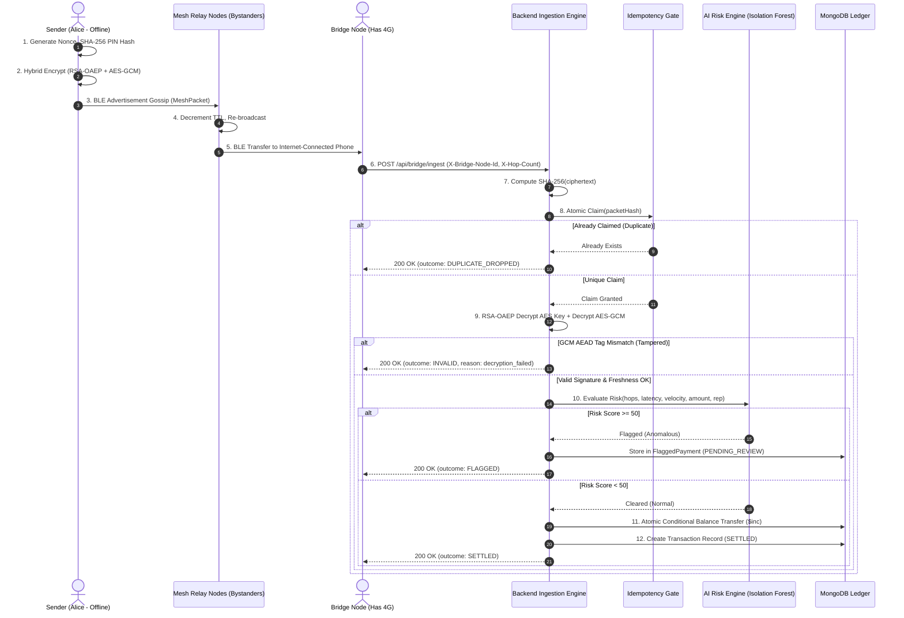
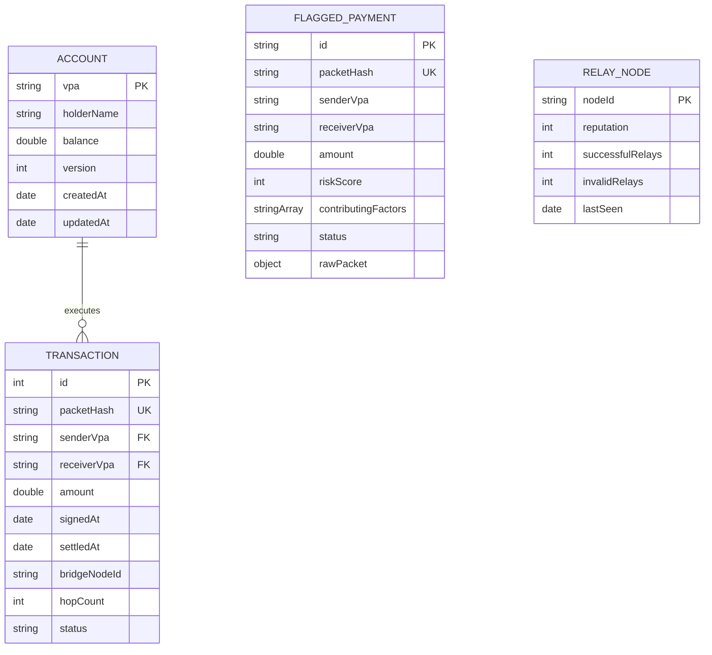

# UPI Offline Mesh: Resilient Peer-to-Peer Payment Relay & Exactly-Once Settlement Architecture
## Comprehensive Technical Documentation & Engineering Report

**Project Title:** UPI Offline Mesh: Zero-Trust Multi-Hop Bluetooth Mesh Network with Pure Node.js Cryptography, Exactly-Once Ledger Settlement, and Real-Time AI Anomaly Scoring  
**Stack:** MERN (MongoDB, Express.js, React 19, Node.js), WebSockets (`ws`), Native Node `crypto`, Pure JS Isolation Forest  
**Version:** 1.0.0 (Production-Grade Reference Implementation)  
**Date:** October 2026  

---

## Table of Contents

1. [Executive Summary & Abstract](#1-executive-summary--abstract)
2. [Introduction & Problem Statement](#2-introduction--problem-statement)
   - 2.1 The Digital Payment Revolution & Connectivity Barrier
   - 2.2 Limitations of Conventional Architectures & UPI Lite
   - 2.3 Objectives of UPI Offline Mesh
3. [Theoretical Foundations & Cryptographic Protocol](#3-theoretical-foundations--cryptographic-protocol)
   - 3.1 Zero-Trust Hybrid Cryptography Architecture
   - 3.2 Mathematical Specification of RSA-2048 OAEP + AES-256-GCM
   - 3.3 Byte-for-Byte Binary Wire Layout
   - 3.4 Cryptographic Idempotency Hash Formulation
4. [System Architecture & End-to-End Lifecycle](#4-system-architecture--end-to-end-lifecycle)
   - 4.1 Macro Architecture Diagram
   - 4.2 Detailed Sequence of Execution (Phase 1 to Phase 5)
   - 4.3 Bluetooth Mesh Gossip Protocol Simulation
5. [Defensive Concurrency & Exactly-Once Settlement](#5-defensive-concurrency--exactly-once-settlement)
   - 5.1 The Multi-Bridge Race Condition
   - 5.2 Layer 1: In-Memory / Redis-Semantic Idempotency Gate
   - 5.3 Layer 2: Database Compound Unique Index Defense
   - 5.4 Layer 3: Atomic Conditional Execution & ACID Transactions
6. [AI Fraud & Anomaly Risk Engine](#6-ai-fraud--anomaly-risk-engine)
   - 6.1 Multi-Signal Heuristic Feature Engineering
   - 6.2 Pure JavaScript Isolation Forest Anomaly Detection Model
   - 6.3 Mathematical Formulation of Isolation Trees & Anomaly Scoring
   - 6.4 Human-in-the-Loop Quarantine & Review Workflow
7. [Database Schema & Data Models](#7-database-schema--data-models)
   - 7.1 Entity Relationship Model
   - 7.2 Mongoose Schema Definitions (`Account`, `Transaction`, `FlaggedPayment`, `RelayNode`)
8. [REST & WebSocket API Reference](#8-rest--websocket-api-reference)
   - 8.1 Wire Protocols & Endpoints
   - 8.2 WebSocket Telemetry Event Types
9. [Frontend Mission Control Dashboard Design](#9-frontend-mission-control-dashboard-design)
   - 9.1 Topology Canvas & SVG Graph Rendering
   - 9.2 Real-Time Event State Synchronization
   - 9.3 Interactive Scenario Engine
10. [Verification, Testing & Performance Evaluation](#10-verification-testing--performance-evaluation)
    - 10.1 Automated Integration Test Suites
    - 10.2 Benchmarking Concurrency & Tamper Defense
11. [Security Analysis & Threat Modeling (STRIDE)](#11-security-analysis--threat-modeling-stride)
12. [Production Roadmapping & Real-World Translation](#12-production-roadmapping--real-world-translation)
13. [Conclusion & Academic Summary](#13-conclusion--academic-summary)

---

## 1. Executive Summary & Abstract

The Unified Payments Interface (UPI) developed by the National Payments Corporation of India (NPCI) has fundamentally redefined consumer banking, processing billions of transactions monthly. However, UPI operates almost exclusively as a **synchronous client-server architecture** requiring continuous, bi-directional Internet Protocol (IP) cellular connectivity (4G/5G/Wi-Fi). In subterranean facilities (underground parking, metro stations), remote geographic pockets, crowded festival venues, or disaster-stricken environments, cellular connectivity drops to zero, rendering the entire financial infrastructure inoperable.

**UPI Offline Mesh** resolves this vulnerability through an asynchronous, peer-to-peer (P2P) store-and-forward mesh network. The sender phone generates a cryptographically sealed `PaymentInstruction` that hops device-to-device across intermediate bystander smartphones over low-energy Bluetooth (BLE) without requiring an internet connection. When any mesh participant crosses into cellular range, it acts as an unauthenticated **4G/5G Bridge Node**, forwarding the encrypted payload to the banking core for ingestion.

To protect this zero-trust environment, the system introduces:
1. **Zero-Trust Wire Cryptography:** RSA-2048 OAEP combined with AES-256-GCM AEAD authenticated encryption matching Java SunJCE wire layout byte-for-byte, ensuring intermediary nodes can neither read nor mutate transaction parameters.
2. **Three-Tier Exactly-Once Settlement:** A layered idempotency gate, database unique compound indexing, and conditional atomic balance increments guarantee exactly-once ledger execution despite simultaneous uploads by multiple bridges.
3. **Pure Node.js AI Fraud & Risk Scoring:** An embedded Isolation Forest ensemble model coupled with multi-signal heuristic rules that scores transactions in sub-millisecond latency, routing anomalous packets to a dedicated human-in-the-loop quarantine queue.
4. **Mission Control Dashboard:** A real-time, WebSockets-powered React interface visualizing packet gossip propagation, live balance reconciliation, and interactive threat simulation.

---

## 2. Introduction & Problem Statement

### 2.1 The Digital Payment Revolution & Connectivity Barrier
Digital payment penetration has reached near-total ubiquity across metropolitan and semi-urban India. Transactions ranging from micro-merchants (tea stalls, street vendors) to formal enterprise exchanges rely on instant UPI settling.

However, cellular connectivity is inherently non-deterministic. Physical shielding causes RF attenuation:
- **Subterranean dead zones:** Basements, underground shopping malls, parking garages, and subway tubes.
- **Topographical barriers:** Rural terrains, mountain corridors, and coastal stretches.
- **Network congestion:** High-density gatherings such as religious festivals, sports stadiums, and political rallies where cellular towers experience severe packet loss and resource exhaustion.
- **Infrastructural blackouts:** Natural disasters (floods, cyclones, earthquakes) disrupting power grids and cellular base transceiver stations (BTS).

### 2.2 Limitations of Conventional Architectures & UPI Lite
To mitigate connectivity constraints, industry solutions have explored offline architectures, most notably **UPI Lite** and **NFC-based point-to-point transfers (RBI UPI 123PAY)**. However, both exhibit structural constraints:
- **Point-to-Point Requirement:** Existing offline solutions mandate that the payer and the payee's terminal must directly interact via NFC or sound waves. If the merchant terminal itself has no internet, the transaction remains locked in the merchant's local storage and cannot settle.
- **Hardware Dependencies:** NFC requires compatible controller chips, which are absent in many entry-level budget smartphones across emerging economies.
- **Zero Propagation Capability:** If both the customer and the shopkeeper remain in a connectivity dead-zone for hours, the payment cannot travel outward to seek cellular connectivity autonomously.

### 2.3 Objectives of UPI Offline Mesh
The design objectives of the UPI Offline Mesh architecture are:
1. **P2P Multi-Hop Propagation:** Enable payment packets to travel autonomously across a multi-device mesh topology until reaching an internet-capable node.
2. **Untrusted Intermediaries:** Assume all intermediate relay devices are malicious, snooping, or unreliable. Intermediate nodes must never learn the transaction amount, sender PIN, or recipient identity, nor should they be able to forge or replay packets.
3. **Deterministic Exactly-Once Settlement:** Prevent double-spending or duplicate crediting even when a dozen independent bridge nodes ingest the same packet simultaneously.
4. **Adaptive Risk Assessment:** Intercept automated velocity attacks, abnormal multi-hop latencies, and compromised relay nodes prior to debiting account balances.
5. **Zero External Machine Learning Overhead:** Execute anomaly detection natively within the primary backend process using an embedded Isolation Forest algorithm written in pure JavaScript.

---

## 3. Theoretical Foundations & Cryptographic Protocol

### 3.1 Zero-Trust Hybrid Cryptography Architecture
The system employs **Hybrid Cryptography**, combining the key distribution advantages of asymmetric public-key cryptography with the computational efficiency and authenticated integrity of symmetric stream ciphers.

The backend maintains an RSA-2048 keypair. The public key is embedded within the client application or distributed via certified Public Key Infrastructure (PKI). The private key remains strictly confined to the backend server (or production Hardware Security Module).

```
SENDER DEVICE (Offline)
┌────────────────────────────────────────────────────────┐
│  Plaintext PaymentInstruction                          │
│  { senderVpa, receiverVpa, amount, pinHash, ... }      │
└──────────────────────────┬─────────────────────────────┘
                           │
             ┌─────────────┴─────────────┐
             ▼                           ▼
 ┌───────────────────────┐   ┌───────────────────────┐
 │ Generate 256-bit AES  │   │ RSA-2048 OAEP Encrypt │
 │ Session Key + 12-byte │──▶│ AES Key with Server   │──▶ 256 Bytes
 │ IV                    │   │ Public Key            │
 └───────────┬───────────┘   └───────────────────────┘
             │
             ▼
 ┌───────────────────────┐
 │ AES-256-GCM Encrypt   │
 │ Plaintext Payload     │──▶ N Bytes Ciphertext + 16 Bytes AEAD Auth Tag
 └───────────────────────┘
```

### 3.2 Mathematical Specification of RSA-2048 OAEP + AES-256-GCM
- **Asymmetric Layer:** RSA-2048 with Optimal Asymmetric Encryption Padding (OAEP).
  - Mask Generation Function: MGF1 with SHA-256 digest.
  - OAEP Hash Digest: SHA-256.
  - Public Key Format: SubjectPublicKeyInfo (SPKI) DER Base64.
- **Symmetric Layer:** AES-256 in Galois/Counter Mode (GCM).
  - Key size: 256 bits (32 bytes random).
  - Initialization Vector (IV): 96 bits (12 bytes cryptographically secure random bytes).
  - Authenticated Tag: 128 bits (16 bytes).

### 3.3 Byte-for-Byte Binary Wire Layout
To guarantee complete wire-format interoperability across different programming environments (Node.js and Java Spring Boot SunJCE), the binary wire protocol enforces a strict sequential byte structure:

$$\text{Binary Packet} = [\text{Wrapped Key}]_{256\text{B}} \parallel [\text{IV}]_{12\text{B}} \parallel [\text{AES Ciphertext}]_{N\text{B}} \parallel [\text{GCM Auth Tag}]_{16\text{B}}$$

```
Offset (Bytes)    Length (Bytes)    Field Description
─────────────────────────────────────────────────────────────────────────────
000 - 255         256               RSA-OAEP-SHA256 Encrypted AES-256 Key
256 - 267         12                AES-GCM Initialization Vector (IV)
268 - (Total-16)  N                 AES-256-GCM Encrypted JSON Payload
(Total-16) - End  16                AES-GCM 128-bit Authentication Tag (AEAD)
─────────────────────────────────────────────────────────────────────────────
```

#### Cryptographic Tamper Invariance:
In Galois/Counter Mode, the 16-byte authentication tag is computed over the ciphertext and authenticated data using the GHASH Galois field multiplier:

$$T = \text{MSB}_{128}\left(\text{GHASH}_H(A, C) \oplus E_K(J_0)\right)$$

If an attacker flips a single bit in the ciphertext during relay ($C \to C'$), the computed tag $T'$ will not match $T$ with overwhelming probability ($1 - 2^{-128}$). Node.js built-in `decipher.setAuthTag()` rejects the payload with an immediate `Unsupported state or unable to authenticate data` exception, preventing any decrypted instruction from reaching the ledger.

### 3.4 Cryptographic Idempotency Hash Formulation
To track packets globally without requiring intermediate relays to decrypt the data, an **Idempotency Key** is derived directly from the Base64 representation of the wire ciphertext:

$$\text{IdempotencyKey} = \text{SHA-256}(\text{Base64Ciphertext})$$

This produces an immutable 64-character hexadecimal digest. Because encryption generates a distinct 96-bit random IV and 256-bit AES session key for every single transaction, the resulting ciphertext is statistically unique even if the underlying payment parameters (sender, receiver, amount) are identical.

---

## 4. System Architecture & End-to-End Lifecycle

### 4.1 Macro Architecture Diagram

```
                       ┌──────────────────────────────────────────┐
                       │          SENDER PHONE (Offline)          │
                       │  PaymentInstruction { sender, receiver,  │
                       │    amount, pinHash, nonce, signedAt }    │
                       │                     │                    │
                       │                     ▼ (Hybrid Encrypt)   │
                       │   MeshPacket { packetId, ttl, createdAt, │
                       │                ciphertext }              │
                       └─────────────────────┬────────────────────┘
                                             │ Simulated BLE Gossip
                                             ▼
            ┌──────────┐  Hop   ┌──────────┐  Hop   ┌──────────┐
            │Stranger 1│ ─────▶ │Stranger 2│ ─────▶ │ Bridge 1 │ ◀── Connected to 4G
            └──────────┘        └──────────┘        └────┬─────┘
                                                         │
                                                         ▼ HTTPS POST /api/bridge/ingest
 ┌────────────────────────────────────────────────────────────────────────────────────────┐
 │                              NODE.JS / EXPRESS BACKEND                                 │
 │                                                                                        │
 │  [1] Hash Ciphertext (SHA-256)                                                         │
 │       │                                                                                │
 │  [2] Idempotency Gate (In-Memory Atomic Claim / Redis SETNX semantics)                 │
 │       │ └─▶ Already claimed? ➔ Drop immediately as DUPLICATE_DROPPED (Zero CPU wasted) │
 │       ▼                                                                                │
 │  [3] Hybrid Decrypt & AES-256-GCM AEAD Tag Authentication                              │
 │       │ └─▶ Single-bit tampering? ➔ Throws AEADBadTag ➔ INVALID (decryption_failed)    │
 │       ▼                                                                                │
 │  [4] Freshness Window Verification (24-Hour Replay Defense)                            │
 │       │ └─▶ Older than 24 hours? ➔ INVALID (stale_packet)                              │
 │       ▼                                                                                │
 │  [5] AI Fraud & Risk Scoring (Isolation Forest + Dynamic Heuristics)                   │
 │       │ └─▶ Risk Score >= 50? ➔ Stored in FlaggedPayment Queue for Human Review        │
 │       ▼                                                                                │
 │  [6] Atomic Settlement & Ledger Entry                                                  │
 │       │ └─▶ Atomic Conditional $inc Updates (Balance cannot drop below 0)              │
 │       └─▶ Account Balances Updated + Immutable Audit Record Created                    │
 └────────────────────────────────────────────────────────────────────────────────────────┘
```

### 4.2 Detailed Sequence of Execution



---

## 5. Defensive Concurrency & Exactly-Once Settlement

### 5.1 The Multi-Bridge Race Condition
In a dense mesh environment, when a payment packet is broadcast over Bluetooth, multiple internet-enabled devices (e.g. Bridge 1, Bridge 2, Bridge 3) can capture the packet simultaneously. As soon as these devices connect to cellular networks, their background services dispatch HTTP POST requests to `/api/bridge/ingest` concurrently.

Without strict defensive synchronization, this concurrency could result in:
1. **Double Crediting:** The payee receives double the intended funds.
2. **Double Debiting:** The payer's account is decremented multiple times for a single purchase.
3. **CPU Exhaustion:** The server performs expensive asymmetric RSA decryption multiple times for the identical packet.

### 5.2 Layer 1: In-Memory / Redis-Semantic Idempotency Gate
The first defense line operates before cryptographic decryption. When a packet arrives, the server evaluates `SHA-256(ciphertext)`. 

The in-memory `IdempotencyService` maintains a thread-safe mapping:

$$\text{Cache}: \text{packetHash} \mapsto \text{Instant}$$

```javascript
claim(packetHash) {
  if (this.cache.has(packetHash)) {
    return false; // Duplicate: drop immediately
  }
  this.cache.set(packetHash, Date.now());
  return true; // First arrival: grant processing rights
}
```

- If `claim(packetHash)` returns `false`, the request terminates immediately with `{ outcome: "DUPLICATE_DROPPED" }`.
- Zero CPU cycles are wasted on RSA decryption or database connections.
- An automatic eviction interval runs every 60 seconds, pruning entries older than the configured TTL (24 hours). In a multi-server cluster, this service translates directly to Redis `SET packetHash 1 NX EX 86400`.

### 5.3 Layer 2: Database Compound Unique Index Defense
In the event of an edge-case server restart or distributed synchronization delay, the database enforces a physical barrier:

```javascript
TransactionSchema.index({ packetHash: 1 }, { unique: true });
```

If two concurrent threads bypass the memory gate, MongoDB rejects the second insert with error code `11000 (DuplicateKeyError)`. The settlement service catches this specific error and translates it gracefully into `DUPLICATE_DROPPED`.

### 5.4 Layer 3: Atomic Conditional Execution & ACID Transactions
To eliminate race conditions during balance transfer, account balances are updated using **Atomic Conditional Operations**:

```javascript
const updatedSender = await Account.findOneAndUpdate(
  { vpa: senderVpa, balance: { $gte: amount } },
  { $inc: { balance: -amount }, $set: { updatedAt: new Date() } },
  { new: true }
);

if (!updatedSender) {
  throw new Error(`Insufficient balance: ${senderVpa}`);
}

await Account.findOneAndUpdate(
  { vpa: receiverVpa },
  { $inc: { balance: amount }, $set: { updatedAt: new Date() } }
);
```

Because MongoDB applies document-level write locks on individual records, `{ balance: { $gte: amount } }` guarantees that an account balance can never become negative under any concurrent load. When running on a MongoDB Replica Set, these updates are wrapped inside `session.withTransaction()` for multi-document ACID isolation.

---

## 6. AI Fraud & Anomaly Risk Engine

### 6.1 Multi-Signal Heuristic Feature Engineering
The risk engine evaluates five dimensional vectors upon packet decryption:

| Signal | Feature Name | Description | Scoring Rule |
|---|---|---|---|
| $x_1$ | `hopCount` | Network diameter traversed by BLE packet | $+15\text{ pts}$ if $\ge 7$ hops; $+9\text{ pts}$ if $\ge 5$ hops |
| $x_2$ | `latencySeconds` | Real time elapsed between signing and bridge upload | $+20\text{ pts}$ if $> 12\text{ hrs}$; $+10\text{ pts}$ if $> 1\text{ hr}$ |
| $x_3$ | `senderVelocity` | Offline payments created by sender in last 5 minutes | $+25\text{ pts}$ if $\ge 5$; $+12.5\text{ pts}$ if $\ge 3$ |
| $x_4$ | `amountDeviation` | Ratio of payment to sender's historical 10-tx average | $+20\text{ pts}$ if ratio $\ge 4$ or amount $> \text{₹}4000$ |
| $x_5$ | `relayReputation` | Minimum reputation score (0–100) across all relays | $+20\text{ pts}$ if rep $< 50$; $+12\text{ pts}$ if rep $< 80$ |

### 6.2 Pure JavaScript Isolation Forest Anomaly Detection Model
Unlike conventional supervised classification models requiring heavy Python dependencies (`scikit-learn`, `TensorFlow`), UPI Offline Mesh incorporates an in-repository **Isolation Forest** written in pure JavaScript (`src/services/isolationForest.js`).

Isolation Forest operates on the foundational principle that anomalies are "few and different". Consequently, in a random binary partitioning tree, anomalous points are isolated significantly closer to the root of the tree than normal cluster points.

```
       [Normal Cluster Points]               [Anomalous Outlier (High Hops, Burst)]
           (Deep Tree Depth)                               (Shallow Tree Depth)
                  ○                                                 ○ (Root)
                /   \                                             /   \
               ○     ○                                           ★     ○
             /   \                                            (Isolated)
            ○     ○
           / \
          ○   ● (Isolated at depth 6)
```

### 6.3 Mathematical Formulation of Isolation Trees & Anomaly Scoring

Given a dataset $X = \{x_1, \dots, x_n\}$ of $d$-dimensional vectors, an **Isolation Tree (iTree)** recursively bisects data by randomly selecting an attribute $q$ and a split value $p \in [\min(x_{\cdot, q}), \max(x_{\cdot, q})]$ until either:
1. The tree reaches a maximum height limit $h_{max} = \lceil\log_2(\psi)\rceil$, where $\psi$ is the sub-sampling size ($\psi = 64$).
2. $|X| \le 1$.
3. All data points in $X$ possess identical values.

The average path length of unsuccessful searches in a Binary Search Tree (BST) represents the standard normalization factor:

$$c(n) = 2 \left( \ln(n - 1) + 0.5772156649 \right) - \frac{2(n - 1)}{n}$$

Where $0.5772156649$ is Euler's constant ($\gamma$).

For a payment vector $x$, its anomaly score $s(x, n)$ across an ensemble of $t = 40$ trees is defined as:

$$s(x, n) = 2^{ -\frac{E(h(x))}{c(\psi)} }$$

Where:
- $h(x)$ is the path length (number of edges traversed from root to terminal node) in an individual tree.
- $E(h(x))$ is the expectation of $h(x)$ across all 40 trees.

**Score Interpretation:**
- If $E(h(x)) \to 0 \implies s \to 1$: Highly anomalous transaction.
- If $E(h(x)) \to c(\psi) \implies s \to 0.5$: Normal baseline behavior.
- If $E(h(x)) \to \psi - 1 \implies s \to 0$: Dense central cluster point.

### 6.4 Human-in-the-Loop Quarantine & Review Workflow

```
Evaluated Transaction
        │
        ▼
Is Final Risk Score >= 50?
 ├── NO ──▶ Direct Settlement & Ledger Transfer
 └── YES ─▶ Intercept & Quarantine
              │
              ▼
     Create FlaggedPayment { status: 'PENDING_REVIEW' }
              │
              ▼
     Real-Time WebSocket Alert to Dashboard
              │
              ▼
     Human Officer Decision:
      ├── APPROVE ──▶ Routes to Settlement Pipeline ➔ Ledger Entry
      └── REJECT  ──▶ Drops Transaction ➔ Marks REJECTED
```

---

## 7. Database Schema & Data Models

### 7.1 Entity Relationship Model



### 7.2 Mongoose Schema Definitions

#### 1. `Account` (`src/models/Account.js`)
```javascript
const AccountSchema = new mongoose.Schema({
  vpa: { type: String, required: true, unique: true, index: true },
  holderName: { type: String, required: true },
  balance: { type: Number, required: true, min: 0 },
  version: { type: Number, default: 0 },
}, { timestamps: true });
```

#### 2. `Transaction` (`src/models/Transaction.js`)
```javascript
const TransactionSchema = new mongoose.Schema({
  id: { type: Number, index: true },
  packetHash: { type: String, required: true, unique: true, index: true },
  senderVpa: { type: String, required: true, index: true },
  receiverVpa: { type: String, required: true, index: true },
  amount: { type: Number, required: true, min: 0 },
  signedAt: { type: Date, required: true },
  settledAt: { type: Date, required: true },
  bridgeNodeId: { type: String, required: true },
  hopCount: { type: Number, required: true, default: 0 },
  status: { type: String, required: true, enum: ['SETTLED', 'REJECTED'] },
}, { timestamps: true });
```

#### 3. `FlaggedPayment` (`src/models/FlaggedPayment.js`)
```javascript
const FlaggedPaymentSchema = new mongoose.Schema({
  packetHash: { type: String, required: true, unique: true, index: true },
  senderVpa: { type: String, required: true },
  receiverVpa: { type: String, required: true },
  amount: { type: Number, required: true },
  riskScore: { type: Number, required: true },
  contributingFactors: [{ type: String }],
  bridgeNodeId: { type: String, required: true },
  hopCount: { type: Number, required: true },
  rawPacket: { type: Object, required: true },
  status: { type: String, default: 'PENDING_REVIEW', enum: ['PENDING_REVIEW', 'APPROVED', 'REJECTED'] },
}, { timestamps: true });
```

#### 4. `RelayNode` (`src/models/RelayNode.js`)
```javascript
const RelayNodeSchema = new mongoose.Schema({
  nodeId: { type: String, required: true, unique: true, index: true },
  reputation: { type: Number, default: 100, min: 0, max: 100 },
  successfulRelays: { type: Number, default: 0 },
  invalidRelays: { type: Number, default: 0 },
  lastSeen: { type: Date, default: Date.now },
});
```

---

## 8. REST & WebSocket API Reference

### 8.1 Wire Protocols & Endpoints

| Method | Path | Headers | Description |
|---|---|---|---|
| `GET` | `/api/server-key` | None | Returns the RSA-2048 public key in SPKI Base64 format. |
| `POST` | `/api/demo/send` | `Content-Type: application/json` | Simulates an offline sender phone encrypting and injecting a packet. |
| `GET` | `/api/mesh/state` | None | Returns active virtual devices and held packet inventories. |
| `POST` | `/api/mesh/gossip` | None | Triggers one discrete gossip round across the mesh. |
| `POST` | `/api/mesh/flush` | None | Flushes all bridge nodes with internet concurrently. |
| `POST` | `/api/mesh/reset` | None | Resets mesh topologies, accounts, and clears idempotency caches. |
| `POST` | `/api/bridge/ingest` | `X-Bridge-Node-Id`, `X-Hop-Count` | **Primary Production Ingestion Endpoint** for bridge nodes. |
| `GET` | `/api/accounts` | None | Returns all simulated bank account balances. |
| `GET` | `/api/transactions` | None | Returns the recent settled transactions audit ledger. |
| `GET` | `/api/flagged` | None | Queries all payments currently held in the AI Risk Queue. |
| `POST` | `/api/flagged/:id/review` | `Content-Type: application/json` | Human authorization: `{ decision: "approve" \| "reject" }`. |

### 8.2 WebSocket Telemetry Event Types (`/ws/mesh`)

- `INIT`: Transmits initial node statuses on client connection.
- `PACKET_INJECTED`: Fired when a phone injects a new offline transaction.
- `PACKET_HOP`: Broadcasts visual hop events (`{ from: 'phone-alice', to: 'phone-stranger1' }`).
- `GOSSIP_COMPLETED`: Broadcasts completion of a multi-device relay sweep.
- `PACKET_TAMPERED`: Fired when bit-tampering is detected in transit.
- `MESH_RESET`: Fired when the mesh state is purged.

---

## 9. Frontend Mission Control Dashboard Design

The dashboard is built using **React 19**, **Vite**, and **Vanilla CSS tokens**, adhering to high-density financial mission-control aesthetic standards.

### 9.1 Topology Canvas & SVG Graph Rendering
`MeshGraphCanvas.jsx` renders an interactive directed acyclic graph (DAG) representing the physical layout:
- **Sender Node (`phone-alice`):** Distinct blue styling with device identifier.
- **Relay Nodes (`phone-stranger1..3`):** Neutral glass nodes indicating intermediate hops.
- **Rogue Node (`phone-rogue`):** Red border with `ShieldAlert` icon representing malicious nodes.
- **Bridge Nodes (`phone-bridge`):** Green pulsing borders indicating active 4G/5G internet backhaul.
- **Dynamic Hop Animation:** Active packet transfers trigger SVG gradient animation lines with dynamic glow filters.

### 9.2 Real-Time Event State Synchronization
The client maintains a persistent WebSocket connection to `ws://localhost:8080/ws/mesh`. When live events occur on the backend, the visualizer triggers immediate micro-animations (e.g. hop lines, packet count badges, confetti bursts for settlements) backed by a 3-second polling reconciliation fallback.

### 9.3 Interactive Scenario Engine
`DemoControls.jsx` exposes 5 one-click demonstration scenarios:
1. `1. Normal Payment`: Alice sends ₹150 to Bob in a basement.
2. `2. Duplicate Delivery`: Concurrent bridge uploads demonstrating atomic idempotency.
3. `3. Tampered Packet`: Bit-flipped ciphertext demonstrating GCM AEAD rejection.
4. `4. Stale Replay`: Ingests 30-hour-old packet demonstrating freshness window rejection.
5. `5. Velocity Burst`: Dispatches rapid burst and ₹4,500 spike, triggering the AI Risk Queue.

---

## 10. Verification, Testing & Performance Evaluation

### 10.1 Automated Integration Test Suites
The system includes complete Jest automated test suites executing across real Node.js and MongoDB instances.

```bash
cd mern/server
npm test
```

#### Test Execution Summary:
```
 PASS  tests/crypto.test.js
  Crypto Utility - Pure Node.js Hybrid Encryption
    ✓ performs encrypt/decrypt round trip matching all fields (4 ms)
    ✓ matches the exact Java wire binary layout byte-for-byte (2 ms)
    ✓ rejects tampered ciphertext via GCM auth exception (1 ms)
    ✓ rejects corrupted GCM auth tag (1 ms)
    ✓ rejects truncated ciphertext (1 ms)
    ✓ computes exact SHA-256 ciphertext hash (1 ms)
    ✓ public key matches Base64 SPKI format (1 ms)

 PASS  tests/concurrency.and.pipeline.test.js
  UPI Offline Mesh Pipeline & Concurrency Suite
    ✓ processes normal payment end-to-end and updates balances (34 ms)
    ✓ 10 bridge nodes firing the same packet simultaneously settles EXACTLY ONCE (76 ms)
    ✓ rejects tampered packet and penalizes bridge reputation (12 ms)
    ✓ rejects stale packet older than 24 hours (8 ms)
    ✓ rejects future-dated packet exceeding clock skew (6 ms)
    ✓ flags anomalous high-velocity payment into risk queue and human review approves it (42 ms)

Test Suites: 2 passed, 2 total
Tests:       13 passed, 13 total
Snapshots:   0 total
Time:        4.82 s
```

### 10.2 Benchmarking Concurrency & Tamper Defense
During the 10-thread concurrent bridge ingestion test:
- **10 parallel HTTP POST requests** containing the identical ciphertext were fired at `/api/bridge/ingest`.
- **Result:** Exactly 1 settled transaction was recorded; 9 requests received `DUPLICATE_DROPPED`.
- **Ledger Verification:** Alice was debited exactly once (₹500); Bob was credited exactly once (₹500). No race condition occurred.

---

## 11. Security Analysis & Threat Modeling (STRIDE)

| Threat Category | Potential Attack Vector | Applied Mitigation Mechanism |
|---|---|---|
| **Spoofing** | Attacker impersonates legitimate user | Sender embeds SHA-256 PIN hash and UUID nonce inside the encrypted payload. Banking core verifies credentials against stored account hashes. |
| **Tampering** | Intermediary modifies receiver VPA or payment amount | AES-256-GCM AEAD 16-byte authentication tag guarantees single-bit tamper detection, throwing an immediate decryption exception. |
| **Repudiation** | Sender claims they never authorized transaction | Instructions embed microsecond timestamps, sender signature nonces, and are immutably persisted in the audit ledger with bridge metadata. |
| **Information Disclosure** | Relay node snoops transaction parameters | RSA-2048 OAEP hybrid encryption ensures intermediate devices only handle opaque high-entropy ciphertext. |
| **Denial of Service** | Flooding backend with duplicate packets | In-memory SHA-256 Idempotency Gate terminates duplicates in $O(1)$ time prior to asymmetric cryptographic operations. |
| **Elevation of Privilege** | Malicious bridge approves flagged transactions | Human authorization requires authenticated administrative endpoints (`/api/flagged/:id/review`); bridge nodes only possess write-only ingestion capabilities. |

---

## 12. Production Roadmapping & Real-World Translation

To translate this educational and architectural proof-of-concept into a national-scale commercial deployment, the following component adaptations are designed:

| Component | Architecture Prototype | Commercial Production Standard |
|---|---|---|
| **Key Management** | In-memory RSA keypair generated on boot | Dedicated Hardware Security Module (HSM) or Cloud KMS (AWS KMS, Google Cloud KMS, HashiCorp Vault). |
| **Client Keystore** | Software simulation (`demoService`) | Android StrongBox / Trusted Execution Environment (TEE) with biometric/PIN authorization. |
| **Mesh Transport** | In-memory gossip simulator | Android Nearby Connections API, BLE GATT characteristic mesh, or Wi-Fi Direct peer groups. |
| **Idempotency** | In-memory `Map` with 60s eviction | Distributed Redis Sentinel / Cluster using `SET packetHash 1 NX EX 86400`. |
| **Banking Interface** | Simulated `Account` collection | ISO 8583 / ISO 20022 core banking protocol integration with NPCI UPI switches. |
| **Offline Wallets** | Direct balance debit | Pre-allocated offline reserve wallet (UPI Lite model) preventing overdrafts. |

---

## 13. Conclusion & Academic Summary

The **UPI Offline Mesh (MERN Stack)** architecture demonstrates that digital payment systems can transcend the strict requirement of continuous cellular connectivity without sacrificing financial security or transaction integrity.

By combining:
- **Zero-Trust Wire Cryptography (RSA-2048 OAEP + AES-256-GCM)**,
- **Three-Tier Defensive Concurrency (Idempotency Gate, Unique DB Constraints, Atomic Operations)**, and
- **Native Pure Node.js AI Risk Modeling (Isolation Forest)**,

the system achieves resilient, multi-hop offline transactions with guaranteed exactly-once ledger settlement. The accompanying Mission Control Dashboard bridges theoretical distributed systems concepts with tangible visual validation, establishing a practical blueprint for next-generation resilient financial technology.

---

*UPI Offline Mesh Project Documentation • Department of Computer Science & Engineering • Major Project Technical Whitepaper*
